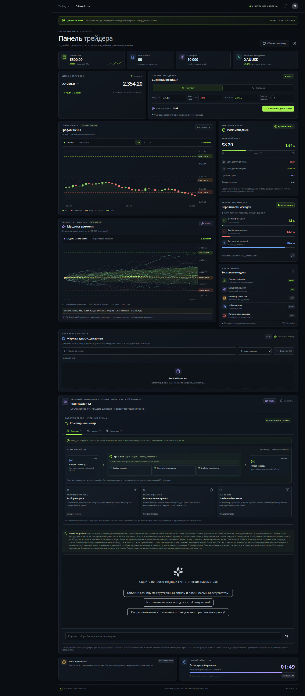
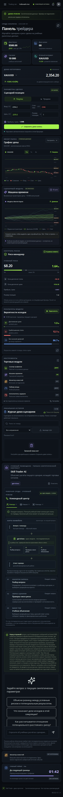

# Skill Trader — обзор проекта

Skill Trader — русскоязычная учебная демо-панель для изучения сценариев риска на синтетических данных. В интерфейсе показаны условные инструменты, графики, визуализация сценариев Монте-Карло, локальный журнал и помощник, объясняющий текущий демонстрационный сценарий.

> **Только учебное демо.** Цены и сценарии синтетические. Это не финансовая рекомендация или прогноз. Приложение не подключено к live-котировкам или брокеру и не отправляет ордера.

This is a project overview only. This repository does not contain the application source code or host a running service. The AI demonstration requires an authorized Manus environment.

## Скриншоты

**Desktop**

**Mobile**

## Короткое видео

[Skill Trader AI — демонстрационный ролик, 5 секунд, без звука](skill-trader-presentation.mp4)

## Спонсорство разработки

Ищу спонсора для дальнейшей разработки и поддержки проекта. Для обсуждения спонсорства свяжитесь с владельцем через [профиль GitHub](https://github.com/mihalmoroz1-eng). Ссылка для финансирования пока не настроена; условия можно обсудить отдельно.

*Seeking a sponsor for continued development and maintenance. For sponsorship enquiries, contact the maintainer through the [GitHub profile](https://github.com/mihalmoroz1-eng).*
